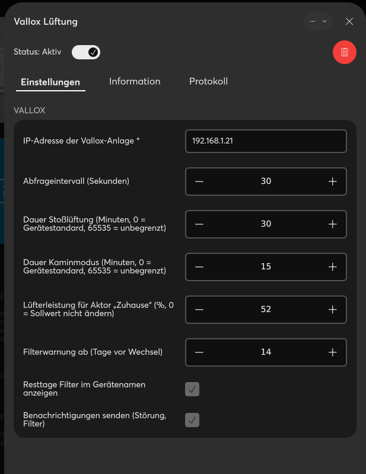

# free@home Add-on: Vallox Lüftung

🇬🇧 *[English version below](#english)*

Bindet eine **MyVallox-Lüftungsanlage** über ihre lokale Websocket-API als virtuelle Geräte in **ABB/Busch-Jaeger free@home** (System Access Point 2.0) ein: Temperaturen, Luftfeuchte und Lüfterleistung anzeigen, Profile (Zuhause, Abwesend, Stoßlüftung, Kamin) schalten, Filter- und Störungsstatus überwachen.

- Kein Cloud-Zugang nötig – das Add-on spricht direkt mit der Anlage im LAN (`ws://<vallox-ip>/`).
- Keine zusätzliche Hardware (kein Modbus-Adapter).
- Getestet mit einer ValloPlus 350 MV (MyVallox Control, Firmware v3) und einem SysAP 2.0.

> Das Protokoll ist aus der Python-Bibliothek [`vallox_websocket_api`](https://pypi.org/project/vallox-websocket-api/) portiert, die auch die Home-Assistant-Integration nutzt. Die Registeradressen entsprechen der Vallox-Modbus-Dokumentation (D5269). Dies ist kein offizielles Produkt von Vallox, ABB oder Busch-Jaeger.

## Inhalt

- [Virtuelle Geräte](#virtuelle-geräte)
- [Installation](#installation)
- [Konfiguration](#konfiguration)
- [Bedienung in free@home](#bedienung-in-freehome)
- [Grenzen](#grenzen)
- [Robustheit und Ressourcen](#robustheit-und-ressourcen)
- [Entwicklung](#entwicklung)
- [English](#english)

Weitere Dokumentation:

- [docs/ENTWICKLUNG.md](docs/ENTWICKLUNG.md) – Aufbau des Codes, lokales Entwickeln, Testen, Paketieren
- [docs/PROTOKOLL.md](docs/PROTOKOLL.md) – Vallox-Websocket-Protokoll, Datenmodell und verwendete Register
- [CHANGELOG.md](CHANGELOG.md)

## Virtuelle Geräte

| Gerät | free@home-Typ | Vallox-Register | Funktion |
|---|---|---|---|
| Vallox Zuluft | Temperatursensor (`AirQualityTemperature`) | 4358 | Zulufttemperatur in °C |
| Vallox Abluft | Temperatursensor | 4354 | Ablufttemperatur in °C |
| Vallox Außenluft | Temperatursensor | 4356 | Außenlufttemperatur in °C |
| Vallox Fortluft | Temperatursensor | 4355 | Fortlufttemperatur in °C |
| Vallox Luftfeuchte | Feuchtesensor (`AirQualityHumidity`) | 4363 | relative Feuchte in %; wird nur angelegt, wenn die Anlage einen Feuchtesensor hat |
| Vallox Lüfter | Deckenlüfter (`CeilingFanActuator`) | 4353; 20507 / 20501 / 20513 | zeigt die aktuelle Lüfterleistung (Schieberegler). Verstellen ändert den Leistungs-Sollwert des **aktiven Profils** (Zuhause, Abwesend oder Boost) |
| Vallox Zuhause | Schaltaktor | 4609, 4612–4614, 20507 | **an** = Profil Zuhause aktivieren: Boost/Kamin/programmierbares Profil beenden und Lüfterleistung „Zuhause“ auf den konfigurierten Wert setzen (Standard 52 %) |
| Vallox Abwesend | Schaltaktor | 4609 | an = Abwesend, aus = Zuhause |
| Vallox Stoßlüftung | Schaltaktor | 4612 | an = Boost für die konfigurierte Dauer, aus = Boost beenden |
| Vallox Kaminmodus | Schaltaktor | 4613 | an = Kaminmodus für die konfigurierte Dauer, aus = beenden |
| Vallox Störung | Binärsensor | 4621 + Fehlertabelle | an = Anlage im Notbetrieb oder aktiver Fehler; zusätzlich free@home-Benachrichtigung |
| Vallox Filterwechsel | Binärsensor | 4620 | an = Filterwechsel fällig (Resttage ≤ Warnschwelle); zusätzlich Benachrichtigung |

Alle Schaltaktoren zeigen immer den **tatsächlichen** Zustand der Anlage – auch wenn an der Anlage selbst, in der Vallox-App oder per Zeitprogramm umgeschaltet wurde.

## Installation

Voraussetzungen:

- free@home System Access Point 2.0 mit Firmware ≥ 3.0.0
- MyVallox-Lüftungsanlage mit Netzwerkanschluss, im selben LAN wie der SysAP, mit fester IP-Adresse (z. B. DHCP-Reservierung im Router)

Schritte:

1. Paket bauen: `npm install && npm run pack` erzeugt `de.private.vallox-<version>.tar` (siehe [Entwicklung](#entwicklung)).
2. In der **free@home next App**: *Mehr → Installationseinstellungen → Add-ons → Upload* und die `.tar`-Datei auswählen.
3. Prüfen, dass das Add-on als **Aktiv** angezeigt wird; sonst manuell starten.
4. In den Einstellungen des Add-ons die **IP-Adresse der Vallox** eintragen.
5. Die neuen Geräte erscheinen nach kurzer Zeit (beim allerersten Start bis zu etwa einer Minute pro Gerät). Sie wie gewohnt Räumen zuordnen und bei Bedarf umbenennen.

Update: neue `.tar` genauso hochladen. Die Geräte bleiben erhalten, Raumzuordnungen und Verknüpfungen auch.

## Konfiguration

In den Einstellungen des Add-ons (App oder Weboberfläche des SysAP):



| Einstellung | Standard | Bedeutung |
|---|---|---|
| IP-Adresse der Vallox-Anlage | – | Pflichtfeld |
| Abfrageintervall | 30 s | 10–600 s |
| Dauer Stoßlüftung | 30 min | 0 = Standard der Anlage, 65535 = unbegrenzt |
| Dauer Kaminmodus | 15 min | 0 = Standard der Anlage, 65535 = unbegrenzt |
| Lüfterleistung für Aktor „Zuhause“ | 52 % | 0 = Sollwert nicht ändern |
| Filterwarnung ab | 14 Tage | Filter-Sensor schaltet und Benachrichtigung kommt, sobald die Resttage diesen Wert erreichen |
| Resttage im Gerätenamen | an | setzt den Gerätenamen auf „Vallox Filter (N Tage)“ – siehe [Grenzen](#grenzen) |
| Benachrichtigungen senden | an | bei Störung und fälligem Filterwechsel |

## Bedienung in free@home

**Profile starten**

| Ziel | Aktion |
|---|---|
| Zuhause (inkl. Standard-Lüfterleistung) | „Vallox Zuhause“ einschalten |
| Abwesend | „Vallox Abwesend“ einschalten |
| zurück auf Zuhause, ohne Leistung zu ändern | „Vallox Abwesend“ ausschalten |
| Stoßlüftung | „Vallox Stoßlüftung“ einschalten – endet nach der eingestellten Dauer automatisch |
| Kaminmodus | „Vallox Kaminmodus“ einschalten – endet nach der eingestellten Dauer automatisch |

Stoßlüftung und Kaminmodus laufen „über“ dem Grundprofil (Zuhause/Abwesend) und schließen sich gegenseitig aus. Nach Ablauf kehrt die Anlage in das Grundprofil zurück.

Die Aktoren lassen sich wie jeder andere free@home-Aktor nutzen:

- direkt in der App antippen,
- mit einem **Taster** verknüpfen (z. B. Stoßlüftung im Bad),
- in **Szenen** einbinden (z. B. „Verlassen“ → Vallox Abwesend an),
- über **Zeitprogramme und Aktionen** des SysAP schalten.

**Lüfterleistung**: Den Schieberegler des Lüfter-Geräts verstellen. Gespeichert wird der neue Wert als Sollwert des gerade aktiven Profils – er gilt also auch beim nächsten Wechsel in dieses Profil. Bis die Lüfter nachgezogen haben, zeigt free@home bis zu 60 Sekunden den gewünschten Wert. Ist die Feuchte- oder CO₂-Regelung der Anlage aktiv, kann die tatsächliche Leistung zeitweise höher liegen.

## Grenzen

- **Lüfterleistung nur als Schieberegler.** free@home hat keinen Gerätetyp, der eine freie Zahl anzeigt; der Deckenlüfter zeigt den Wert nur grafisch.
- **Filter-Resttage erscheinen nicht in der App.** Das Add-on kann nur den *Gerätenamen* setzen, die App zeigt aber den *Kanalnamen*. Den kann nur der Benutzer in der App ändern. Der Filter-Sensor und die Benachrichtigung funktionieren unabhängig davon.
- **An/Aus am Lüfter-Gerät ist nur Anzeige.** Das Ausschalten der kompletten Anlage wird bewusst nicht angeboten.
- **Lüfterleistung im Kaminmodus nicht einstellbar** – die Anlage regelt dort Zu- und Abluft getrennt.
- Das **programmierbare Profil** der Vallox wird nur beendet, nicht gestartet.

## Robustheit und Ressourcen

- Pro Abfrage eine kurzlebige Websocket-Verbindung mit Timeout und drei Wiederholungen – keine hängenden Verbindungen, Reconnect ist implizit.
- Ist die Anlage nicht erreichbar, wird mit wachsendem Abstand bis höchstens alle 5 Minuten abgefragt. Nach 3 Minuten ohne Antwort werden alle Geräte im SysAP als „nicht erreichbar“ markiert, danach automatisch wieder aktiv.
- Keep-Alive der virtuellen Geräte alle 10 Minuten (Lebensdauer im SysAP 30 Minuten) – nur solange die Vallox antwortet.
- Datenpunkte werden nur bei Wertänderungen geschrieben; nach einem Verbindungsabbruch zum SysAP wird alles neu übertragen.
- Gemessen ca. 45 MB Arbeitsspeicher (SysAP-Limit pro Add-on: 64 MB) und im Mittel wenige Prozent CPU.

## Entwicklung

```bash
npm install
npm test                          # Unit-Tests
npm run probe -- <vallox-ip>      # Verbindung testen und Werte ausgeben (--raw, --watch)
cp .env.example .env              # SysAP-Adresse, Benutzer, Passwort, Vallox-IP eintragen
npm run dev                       # Add-on lokal gegen den SysAP laufen lassen
npm run pack                      # Installationspaket de.private.vallox-<version>.tar bauen
```

Details in [docs/ENTWICKLUNG.md](docs/ENTWICKLUNG.md).

---

## English

A **free@home add-on** (ABB/Busch-Jaeger, System Access Point 2.0) that exposes a **MyVallox ventilation unit** as virtual free@home devices via the unit's local websocket API (`ws://<vallox-ip>/`). No cloud and no Modbus adapter needed. Tested with a ValloPlus 350 MV (MyVallox Control, firmware v3).

The protocol is ported from the Python library [`vallox_websocket_api`](https://pypi.org/project/vallox-websocket-api/) used by Home Assistant; register addresses match the Vallox Modbus documentation (D5269). Not an official Vallox, ABB or Busch-Jaeger product.

### Devices

| Device | free@home type | What it does |
|---|---|---|
| Vallox Zuluft / Abluft / Außenluft / Fortluft | temperature sensor | supply, extract, outdoor and exhaust air temperature (°C) |
| Vallox Luftfeuchte | humidity sensor | relative humidity (%), only created if the unit has a humidity sensor |
| Vallox Lüfter | ceiling fan actuator | shows the current fan speed (slider); changing it sets the speed of the **active profile** (Home, Away or Boost) |
| Vallox Zuhause | switch actuator | **on** = activate Home: end Boost/Fireplace/programmable mode and set the Home fan speed to the configured value (default 52 %) |
| Vallox Abwesend | switch actuator | on = Away, off = Home |
| Vallox Stoßlüftung | switch actuator | on = Boost for the configured duration, off = stop |
| Vallox Kaminmodus | switch actuator | on = Fireplace mode for the configured duration, off = stop |
| Vallox Störung | binary sensor | on = unit fault / limp mode or active alarm, plus a free@home notification |
| Vallox Filterwechsel | binary sensor | on = filter change due (remaining days ≤ threshold), plus a notification |

All actuators always show the unit's **actual** state, including changes made on the unit, in the Vallox app or by its weekly schedule.

### Installation

1. Requirements: SysAP 2.0 with firmware ≥ 3.0.0; Vallox unit on the same LAN with a fixed IP address.
2. Build the package: `npm install && npm run pack` creates `de.private.vallox-<version>.tar`.
3. In the **free@home next app**: *More → Installation settings → Add-ons → Upload*, select the `.tar` file and make sure the add-on is shown as **Active**.
4. Enter the **Vallox IP address** in the add-on settings.
5. Assign the new devices to rooms. On first start, creating a device can take up to about a minute.

To update, upload the new `.tar` the same way; devices, rooms and links are kept.

### Configuration

| Setting | Default | Meaning |
|---|---|---|
| Vallox IP address | – | required |
| Polling interval | 30 s | 10–600 s |
| Boost duration | 30 min | 0 = unit default, 65535 = unlimited |
| Fireplace duration | 15 min | 0 = unit default, 65535 = unlimited |
| Fan speed for “Zuhause” actuator | 52 % | 0 = keep current setting |
| Filter warning threshold | 14 days | |
| Remaining filter days in device name | on | see limitations |
| Send notifications | on | fault and filter change |

### Usage

Switch the actuators in the app, link them to **push buttons** (e.g. Boost in the bathroom), use them in **scenes** (e.g. “Leaving” → Away on) or in SysAP **timers and actions**. Boost and Fireplace run on top of Home/Away, exclude each other and end automatically after their duration.

### Limitations

- The fan speed is only shown as a slider – free@home has no device type for a free numeric value.
- Remaining filter days do not appear in the app: the add-on can only set the *device* name, while the app shows the *channel* name.
- On/off of the fan device is display only; switching the whole unit off is intentionally not offered.
- The fan speed cannot be set in Fireplace mode (supply and extract are controlled separately there).

### Development

```bash
npm install
npm test                          # unit tests
npm run probe -- <vallox-ip>      # read and print values (--raw, --watch)
cp .env.example .env              # SysAP address, user, password, Vallox IP
npm run dev                       # run locally against the SysAP
npm run pack                      # build the add-on package
```

Further documentation (German): [docs/ENTWICKLUNG.md](docs/ENTWICKLUNG.md) (code structure, testing, packaging) and [docs/PROTOKOLL.md](docs/PROTOKOLL.md) (websocket protocol, data model, registers).

## Lizenz / License

[MIT](LICENSE)
